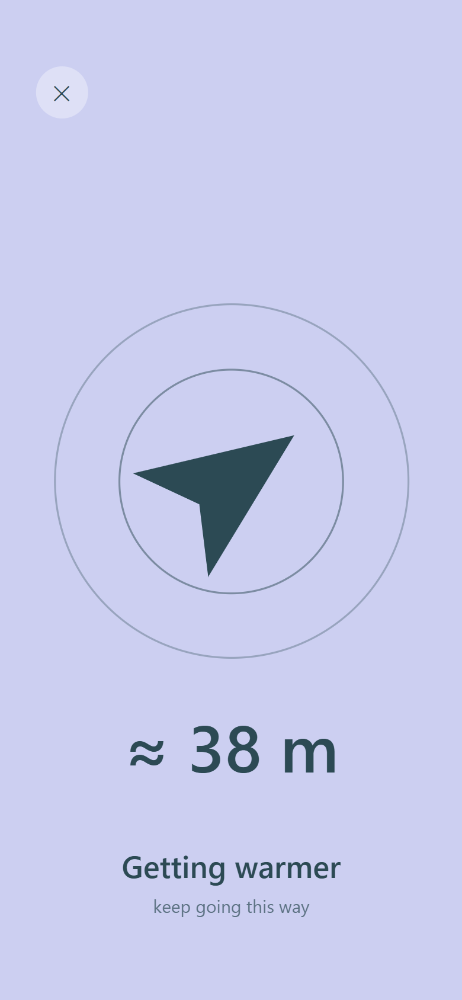

# BreakPoint

<p>
  
  
</p>

<sub>Web build with a simulated signal, not two phones.</sub>

Two people agree to meet in a park. The park is big, the phones say they are 30 metres apart, and they still spend ten minutes looking for each other. GPS is good at getting you to the right block; it is not good at the last hundred metres. BreakPoint is a small mobile app for that last stretch: once two phones are close, it uses Bluetooth Low Energy to tell each one whether the other is getting nearer or farther, until they are face to face.

## How it works

Both phones join a short-lived session on the server and receive a private Bluetooth identifier for it, then start advertising and scanning over BLE. Signal strength is noisy, so the app does not try to compute a distance; it watches the signal trend over a few seconds and shows a simple hotter or colder signal. The server side is a Cloudflare Worker with one Durable Object per session, which holds the pairing state and expires on its own. The session holds the last known position of each phone while it runs and clears it when it ends. An empty marker stays for a day so that someone joining late sees "expired" rather than "not found". No account, no positions, nothing else.

## Stack

Expo and React Native with a native BLE module, Hono on Cloudflare Workers, a Durable Object per session, a shared protocol package, pnpm and Turborepo.

## Status

Version 3 in progress. The backend, the session protocol and the signal processing are covered by unit and integration tests and run locally and on the web build, where in development a console function feeds a running session a simulated Bluetooth signal. The native Bluetooth module for Android and iOS is written but has not yet been built or tested on a real device, so outdoor and indoor reliability is still unmeasured; iOS does not keep scanning in the background yet. This is a side project I pick up between other things.

## Run it

You need Node 22 (see `.nvmrc`) and pnpm 10 (`corepack enable` picks the version pinned in `package.json`).

```sh
pnpm install
```

**Backend.** Runs the Worker and its Durable Object locally on `http://127.0.0.1:8787`:

```sh
pnpm --filter @breakpoint/backend dev
```

**App on the web, no phone needed.** In a second terminal:

```sh
EXPO_PUBLIC_API_URL=http://127.0.0.1:8787 pnpm --filter @breakpoint/mobile web
```

Open two browser windows, one per person. In the first, tap Find someone and copy the invite link; open it in the second. Both land on the Finding screen. There is no Bluetooth on the web, so feed one side a signal from the browser console, about once a second:

```js
breakpointSignal(-75) // then -72, -68... to get warmer
```

The diagnostics screen (Profile, then Diagnostics) replays an injected signal through the same pipeline and lets you tune the thresholds live.

**App on phones.** The BLE module is native code, so Expo Go cannot run it: you need a development build, which needs the Android SDK or Xcode, and two physical devices, since emulators have no Bluetooth between them.

```sh
pnpm --filter @breakpoint/mobile android
pnpm --filter @breakpoint/mobile ios
```

Point `EXPO_PUBLIC_API_URL` at an address both phones can reach, or deploy the Worker with `pnpm --filter @breakpoint/backend deploy`.

**Tests.**

```sh
pnpm lint
pnpm typecheck
pnpm test
```

`pnpm test` runs the app's unit tests. The end-to-end tests talk to a running backend, so start `dev` first:

```sh
pnpm --filter @breakpoint/backend test
pnpm --filter @breakpoint/mobile test:integration
```

## License

MIT
